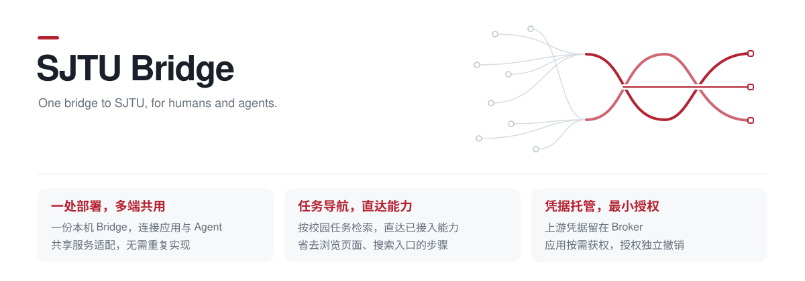

# SJTU Bridge



把上海交通大学校园服务接入命令行、应用和 AI 助手。公开信息直接查询，个人数据按应用授权，权限可随时撤销。

项目处于开发阶段，当前仅提供只读能力，以 Windows 为主要开发与验证平台。

## 核心亮点

- **一处部署，多端共用**：本机安装一份 Bridge，第三方应用与 Agent 通过 CLI、MCP 或 Client SDK 接入，共享校园服务适配与个人服务的单实例 Broker，无需各自维护门户对接与认证逻辑。
- **任务导航，直达能力**：按校园任务组织服务，提供中文别名、关键词和统一调用契约。Agent 可直接检索并调用已接入的能力，省去浏览页面、搜索入口的步骤；尚未接入的业务提供官方入口导航并标明接入状态。
- **凭据托管，最小授权**：受支持的上游凭据留在本机 Broker，应用持有独立授权，按需限定能力、账号、课程与返回视图，并可单独撤销。减少向第三方应用分发高权限凭据带来的越权风险。

当前个人服务支持 Canvas Token 托管；JAAuthCookie 仅用于独立诊断，尚不支持持久导入与业务授权。应用限权的具体边界见[安全模型](docs/security.md)。

## 项目定位

校园服务分散在不同门户，入口、数据格式和认证方式各不相同。查找一项服务、为应用接入数据，往往需要重复寻找入口、适配接口并处理凭据。

SJTU Bridge 提供统一的访问层，让用户通过命令行查询信息，让开发者通过稳定的能力契约接入服务，也让 Agent 通过 MCP 使用同一套能力。个人服务的凭据由本机 Broker 托管，应用只获得指定账号、课程和字段范围内的权限。

当前接入包括：

- **公开数据查询**：校历、借阅规则、教务与校园公告、超算硬件、收费公示、网络支持和机构目录，无需登录。
- **Canvas 作业查询**：读取已授权课程的作业与截止时间，支持按应用授权和独立撤销。
- **官方服务导航**：定位第二课堂、场馆预约、缴费等尚未接入的业务入口，明确查询范围和接入状态。

## 快速开始

准备 [go.mod](go.mod) 指定版本的 Go，在 Windows PowerShell 的仓库根目录构建：

```powershell
. .\scripts\dev-env.ps1
.\scripts\build.ps1
```

公开查询无需登录或启动后台进程：

```powershell
.\bin\sjtu.exe capabilities search 校历
.\bin\sjtu.exe public calendars list --json
.\bin\sjtu.exe library borrowing list --json
```

使用 `--help` 查看命令，使用 `capabilities list` 查看当前可用能力，使用 `capabilities describe 能力ID` 查看输入输出。查询结果包含来源、时间、分页和覆盖范围。

## 接入应用与 Agent

支持 CLI、MCP stdio 和 Go Client SDK。MCP 宿主可用以下命令接入公开能力：

```powershell
.\bin\sjtu.exe mcp serve
```

个人服务先使用 `broker init` 初始化，再以 `broker run` 保持服务运行；在另一终端使用 `auth import`、`apps create` 和 `permissions grant` 完成配置，参数见各命令的 `--help`。Canvas Token 在终端隐藏输入；应用通过独立连接文件访问，不取得上游凭据。

配置个人能力的 MCP 宿主时，使用 `mcp serve --connection 应用连接文件绝对路径`。连接文件需保存在私有目录，宿主配置只引用路径。使用 `permissions revoke` 撤销授权，或使用 `apps revoke` 撤销整个应用。

## 开发

项目使用 Go、Cobra 和官方 MCP Go SDK，采用模块化单体结构。

```powershell
go test ./...
go vet ./...
```

公共 Go API 位于 [bridge](bridge/)，连接 Broker 的 Client SDK 位于 [client](client/)，能力契约与目录位于 [contracts](contracts/)，校园服务适配位于 [internal/providers](internal/providers/)。新增能力须显式注册和授权，分类本身不授予权限。
